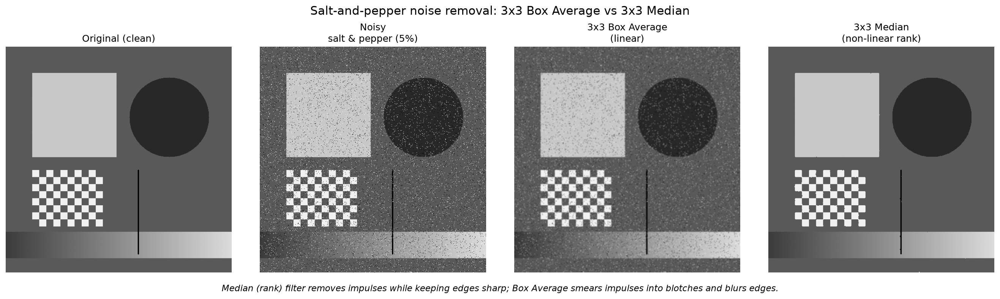

# Noise Suppression using Box and Median Filters

A comparison of a **linear** smoothing filter (3×3 Box Average) and a **non-linear** rank-order filter (3×3 Median) for removing **salt-and-pepper (impulse) noise** from grayscale images, built with OpenCV and NumPy.



## Overview

The script:

1. Loads a grayscale image, or generates a 512×512 synthetic test image if you don't give it one.
2. Adds salt-and-pepper noise: a set fraction of pixels is forced to `0` (pepper) or `255` (salt).
3. Filters the noisy image with:
   - `cv2.blur(img, (3, 3))`: **3×3 Box Average**, the mean of each window (linear).
   - `cv2.medianBlur(img, 3)`: **3×3 Median**, the middle value of each sorted window (non-linear).
4. Scores each result against the clean original with **MSE**, **PSNR** and **Laplacian variance** (a measure of how sharp the edges are).
5. Saves a side-by-side figure to `comparison_plot.png`.

The synthetic test image includes flat regions, straight and curved edges, a checkerboard texture, a smooth gradient and a thin 2-pixel line. This mix shows how each filter handles real edges compared with isolated noise pixels.

## Results

Default run: synthetic image, 5% noise density, `np.random.seed(42)`.

| Stage                    | MSE ↓   | PSNR (dB) ↑ |
|--------------------------|--------:|------------:|
| Noisy (unfiltered)       | 972.32  | 18.25       |
| 3×3 Box Average (linear) | 182.51  | 25.52       |
| 3×3 Median (non-linear)  | **12.38** | **37.20** |

| Edge sharpness (Laplacian variance) | Value |
|-------------------------------------|------:|
| Clean original                      | 656   |
| 3×3 Box Average                     | 441   |
| 3×3 Median                          | 707   |

**The Median filter wins clearly**, scoring about 12 dB higher PSNR than the Box filter.

### Why the median wins

- **The Box Average is linear.** Each output pixel is a weighted sum of its window. An impulse at 0 or 255 is an outlier, and a mean has no defence against outliers. The impulse gets folded into the neighbourhood average and spread into a grey blotch, while every real edge is averaged across and softened.
- **The Median is a rank (order-statistic) filter.** It uses only where a value falls in the sorted order, not how large it is. Impulses sit at the ends of the sorted window, so while fewer than half of the 9 pixels are corrupted, the median is a clean pixel and the impulse is simply dropped.
- **Edges survive the median.** On an edge, the window holds pixels from both sides, and the median takes the value of whichever side has the majority. The step stays sharp instead of turning into a ramp.

> **Caveat:** the median's advantage lasts only while noise is moderate. Once roughly 40–50% of pixels are corrupted, impulses stop being a minority in each window and the median starts to fail too.

> **Note:** the median's Laplacian variance (707) is slightly *above* the clean image's (656). Laplacian variance measures high-frequency energy, and the few impulses the median leaves behind add a little of it back. Read that number as "edges preserved", not "sharper than the original".

## Getting started

### Requirements

- Python 3.8+
- OpenCV, NumPy, Matplotlib

```bash
pip install -r requirements.txt
```

### Usage

```bash
# Use the built-in synthetic test image (5% noise)
python assignment2_2430010039.py

# Use your own image
python assignment2_2430010039.py path/to/image.jpg

# Use your own image with a custom noise density (e.g. 10%)
python assignment2_2430010039.py path/to/image.jpg 0.10
```

The script prints metrics to the console and writes `comparison_plot.png` to the current directory. Matplotlib uses the headless `Agg` backend, so no display is needed.

## Project structure

```
.
├── assignment2_2430010039.py   # Main script: noise, filtering, metrics, plot
├── comparison_plot.png         # Output figure from the default run
├── requirements.txt            # Python dependencies
└── README.md
```

## Key concepts

| Concept | Box Average | Median |
|---|---|---|
| Filter type | Linear (convolution) | Non-linear (rank / order statistic) |
| Can be written as a kernel? | Yes, every weight is 1/9 | No |
| Effect on impulses | Smears them into blotches | Removes them |
| Effect on edges | Blurs them | Keeps them |
| Speed | Very fast (separable) | Slower (needs sorting) |

## Author

**Pratyush**
